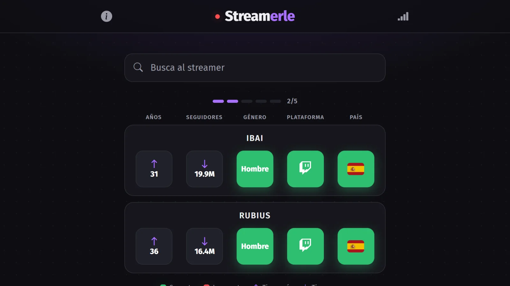
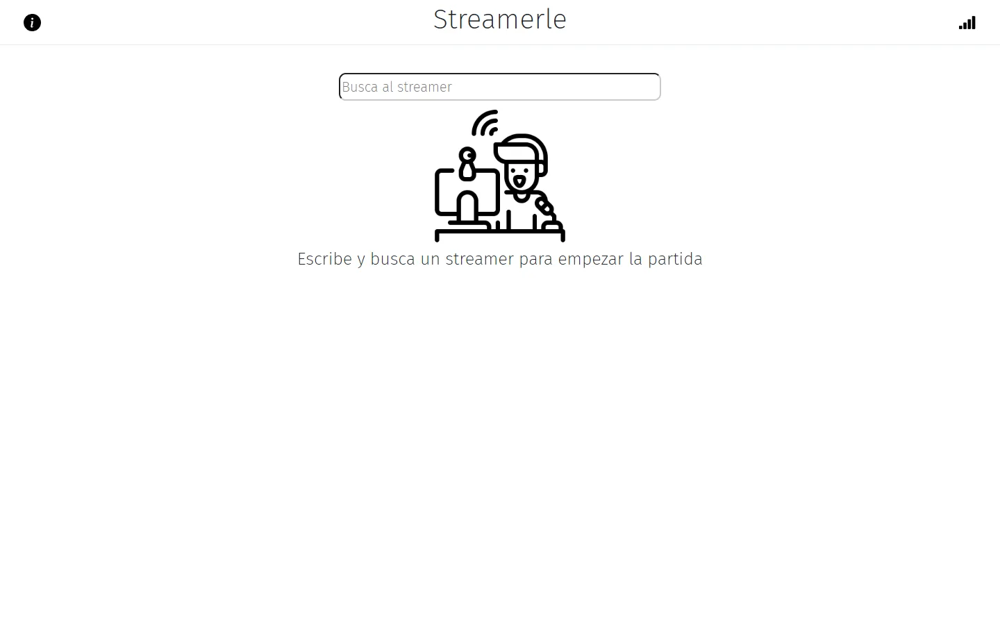
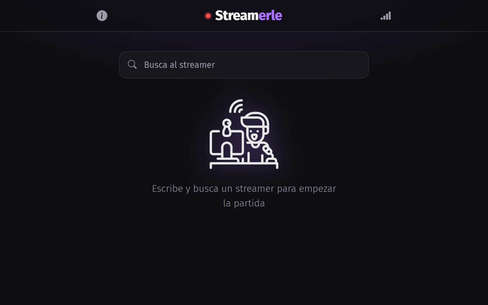
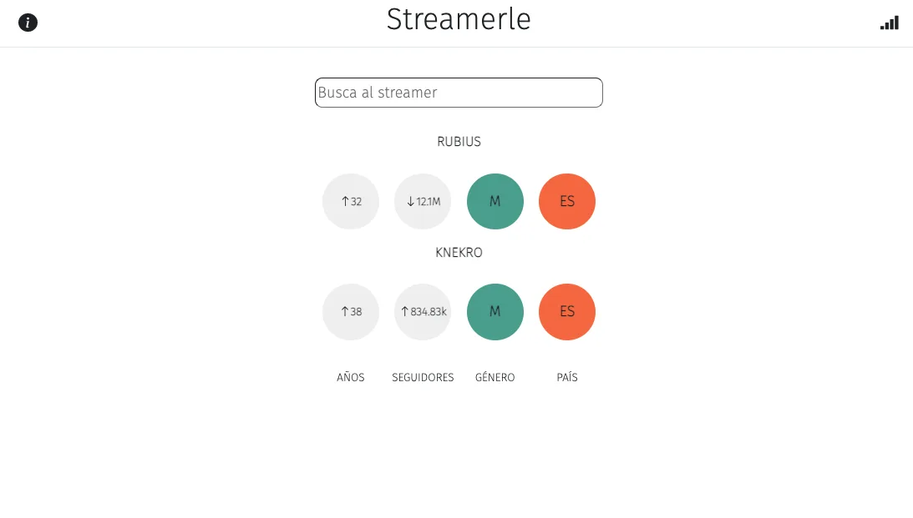
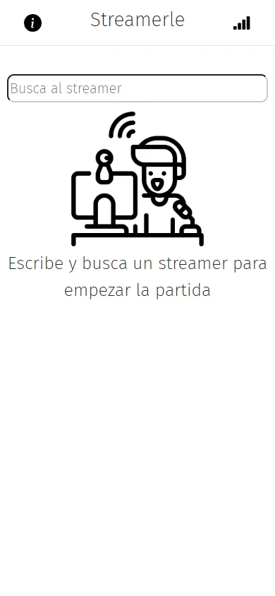
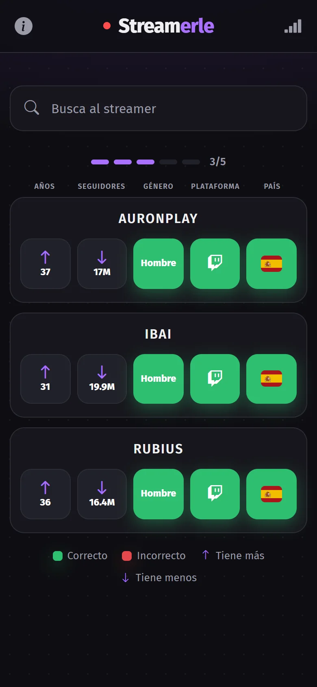

# Streamerle

> A Wordle for streamers, made in 2022 and redesigned in 2026. One streamer a day: guess who it is from the clues each attempt gives you.

**Play it:** https://streamerle.vercel.app · UI in Spanish



## Why this repo exists

Streamerle was one of my first projects, built in 2022 when Wordle clones were everywhere and I wanted one about the streamers I watched. In 2026 I went back to it and redesigned the whole interface, keeping the game as it was.

It stays public with its history because the before and after says more about how I work now than a new project would.

## Then and now

| 2022 | 2026 |
| --- | --- |
|  |  |
|  |  |
|  |  |

**Where it started**

- Create React App as the base.
- React Bootstrap with its default styles.
- A plain black-and-white layout, with no identity of its own.

**What the 2026 pass changed**

- Dark mode and a visual identity.
- Clues by colour and arrow, readable at a glance.
- An attempts bar, and the streamer's platform as a new clue.
- A layout that works on the phone, which is where most people play.

**What I would do differently today**

- Fetch the streamers from the platforms' APIs instead of a JSON file: follower counts go stale.
- Tests for the clue logic. It is pure functions and the easiest part of the app to test.

## How to play

1. Type a streamer's name. The search suggests names as you type.
2. Every guess reveals a clue per column: platform, gender, country, age and followers. Green means a match; arrows tell you whether the answer is higher or lower.
3. You have a limited number of attempts and a new streamer every day. When you finish, share your result and wait for the countdown.

## Features

- Daily game: the same streamer for everyone, with a countdown to the next one.
- Around 90 Spanish-speaking streamers from Twitch, YouTube and Kick.
- Search with autocomplete.
- Clues for platform, gender, country, age and followers.
- Your stats and today's game are kept in the browser, no account needed.
- Share your result on social networks.

## Tech stack

| | |
| --- | --- |
| UI | React, React Bootstrap |
| Data | Local JSON with the streamers |
| Persistence | localStorage |
| Sharing | react-share |
| Tooling | Create React App |

## Getting started

```bash
git clone https://github.com/emepuchades/streamerle.git
cd streamerle
npm install
npm start
```

The app opens at http://localhost:3000.

## License

[MIT](LICENSE) · Made by [María Puchades](https://github.com/emepuchades)
